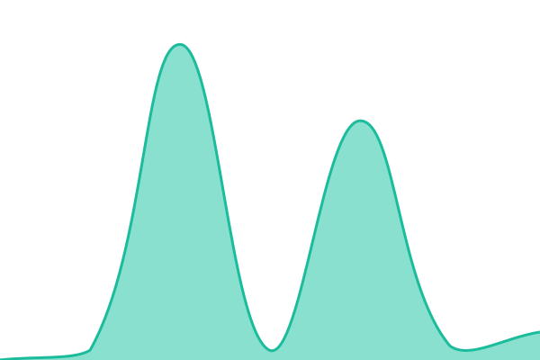

# [📈 Live Status](https://status.teplostanski.me): <!--live status--> **🟩 All systems operational**

This repository contains the open-source uptime monitor and status page for [teplostanski](https://teplostanski.me), powered by [Upptime](https://github.com/upptime/upptime).

With [Upptime](https://upptime.js.org), you can get your own unlimited and free uptime monitor and status page, powered entirely by a GitHub repository. We use [Issues](https://github.com/teplostanski/status-teplostanski-me/issues) as incident reports, [Actions](https://github.com/teplostanski/status-teplostanski-me/actions) as uptime monitors, and [Pages](https://status.teplostanski.me) for the status page.

<!--start: status pages-->
<!-- This summary is generated by Upptime (https://github.com/upptime/upptime) -->
<!-- Do not edit this manually, your changes will be overwritten -->
<!-- prettier-ignore -->
| URL | Status | History | Response Time | Uptime |
| --- | ------ | ------- | ------------- | ------ |
|  [teplostanski.me](https://teplostanski.me) | 🟩 Up | [teplostanski-me.yml](https://github.com/teplostanski/heartbeat-teplostanski-me/commits/HEAD/history/teplostanski-me.yml) | 

 385ms
     
 | 

<a href="https://heartbeat.teplostanski.me/history/teplostanski-me">100.00%</a>
    

|  [thanks.teplostanski.me](https://thanks.teplostanski.me) | 🟩 Up | [thanks-teplostanski-me.yml](https://github.com/teplostanski/heartbeat-teplostanski-me/commits/HEAD/history/thanks-teplostanski-me.yml) | 

 455ms
     
 | 

<a href="https://heartbeat.teplostanski.me/history/thanks-teplostanski-me">100.00%</a>
    

|  [masonry-gallery-tailwind](https://masonry-gallery.demo.teplostanski.me) | 🟩 Up | [masonry-gallery-tailwind.yml](https://github.com/teplostanski/heartbeat-teplostanski-me/commits/HEAD/history/masonry-gallery-tailwind.yml) | 

 429ms
     
 | 

<a href="https://heartbeat.teplostanski.me/history/masonry-gallery-tailwind">100.00%</a>
    

|  [spec.repattern.dev](https://spec.repattern.dev) | 🟩 Up | [spec-repattern-dev.yml](https://github.com/teplostanski/heartbeat-teplostanski-me/commits/HEAD/history/spec-repattern-dev.yml) | 

 570ms
     
 | 

<a href="https://heartbeat.teplostanski.me/history/spec-repattern-dev">100.00%</a>
    

|  [newround](https://newround.teplostanski.me) | 🟩 Up | [newround.yml](https://github.com/teplostanski/heartbeat-teplostanski-me/commits/HEAD/history/newround.yml) | 

 588ms
     
 | 

<a href="https://heartbeat.teplostanski.me/history/newround">100.00%</a>
    

|  [vite-plugin-readable-classnames](https://vite-plugin-readable-classnames.js.org) | 🟩 Up | [vite-plugin-readable-classnames.yml](https://github.com/teplostanski/heartbeat-teplostanski-me/commits/HEAD/history/vite-plugin-readable-classnames.yml) | 

 183ms
     
 | 

<a href="https://heartbeat.teplostanski.me/history/vite-plugin-readable-classnames">100.00%</a>
    

<!--end: status pages-->

[**Visit our status website →**](https://status.teplostanski.me)

## 📄 License

- Powered by: [Upptime](https://github.com/upptime/upptime)
- Code: [MIT](./LICENSE) © [Anand Chowdhary](https://anandchowdhary.com)
- Data in the `./history` directory: [Open Database License](https://opendatacommons.org/licenses/odbl/1-0/)
